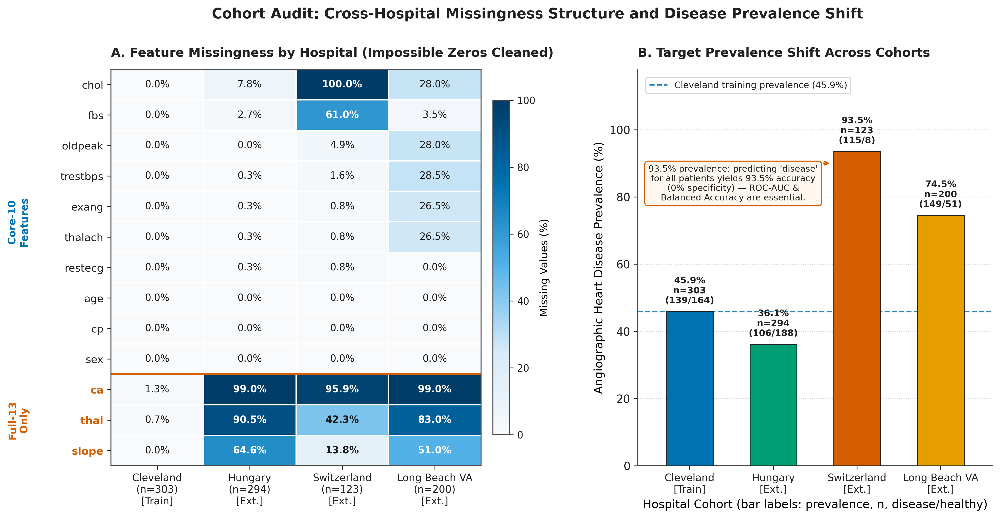
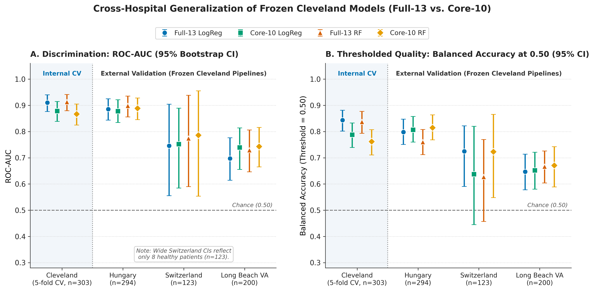
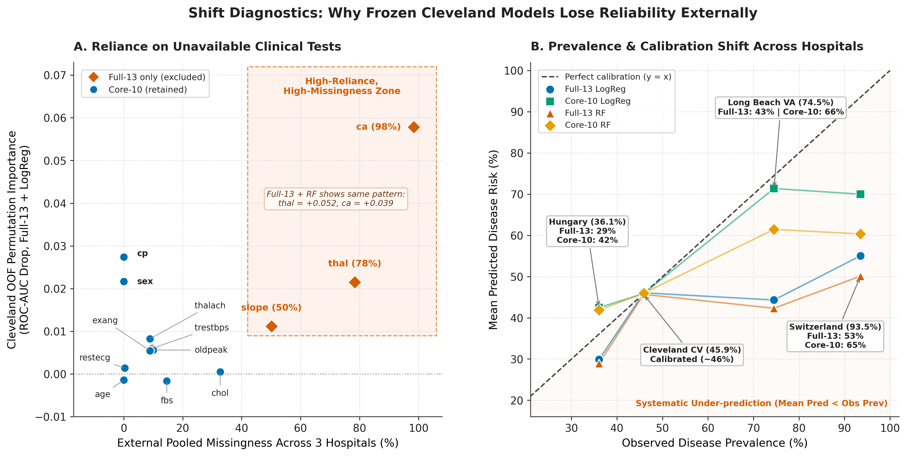

# Cross-Hospital External Validation of Heart Disease Prediction

Does a heart disease prediction model trained on patients from a single hospital (**Cleveland**, $n=303$) still generalize when evaluated on three independent hospitals (**Hungary** $n=294$, **Switzerland** $n=123$, **Long Beach VA** $n=200$)?

Most tutorials using the public [UCI Heart Disease dataset](https://archive.ics.uci.edu/dataset/45/heart+disease) train and test exclusively on the 303 Cleveland patients and ignore the remaining 617 patients from three other clinical sites. This project implements a **pre-specified, leakage-free validation pipeline** to test cross-hospital transportability and diagnose **missingness shift**, **covariate shift**, and **prevalence/calibration shift**.

> **Full Technical Report (1–2 pages):** Read [`report/report.md`](report/report.md) for the complete methods, shift diagnostics, limitations, and clinical ML takeaways.

---

## Project Status

- [x] **Step 0:** Pre-specified experimental protocol locked in [`MASTERPLAN.md`](MASTERPLAN.md)
- [x] **Step 1:** Data download & four-hospital cohort/missingness audit ([`src/01_audit_data.py`](src/01_audit_data.py))
- [x] **Step 2:** Internal 5-fold cross-validation & frozen model training on Cleveland ([`src/02_train_internal.py`](src/02_train_internal.py))
- [x] **Step 3:** External validation across Hungary, Switzerland & Long Beach VA + shift diagnostics & 3 figures ([`src/03_evaluate_external.py`](src/03_evaluate_external.py))
- [x] **Step 4:** Concise 1–2 page technical report ([`report/report.md`](report/report.md)) & deterministic end-to-end verification
- [ ] **Step 5:** Independent Devil's Advocate / QA audit & final polish

---

## Headline Findings

1. **Internal Cleveland superiority disappears across hospitals:** Inside Cleveland (5-fold CV), the standard `Full-13` tutorial models lead `Core-10` by **+0.032 to +0.046 ROC-AUC** (`0.911–0.913` vs. `0.867–0.878`). Outside Cleveland, `Full-13` loses this advantage and suffers a sharp collapse in sensitivity (`0.470–0.574` in Switzerland and Long Beach VA).
2. **Why `Full-13` breaks externally (Missingness Shift):** `Full-13` relies heavily on three tests—`ca`, `thal`, and `slope`—that are missing in **98.4%**, **78.4%**, and **50.1%** of external patients. Because Cleveland's training median (`ca = 0`), mode (`thal = 3`), and mode (`slope = 1`) correspond to *healthy* findings, imputing unavailable external tests systematically pushes `Full-13` toward false negatives.
3. **Portable `Core-10` improves reliability externally:** Dropping `ca`, `thal`, and `slope` surpasses `Full-13` on ROC-AUC in Switzerland and Long Beach VA while substantially improving pooled external **Balanced Accuracy** (`0.774–0.782` vs. `0.720–0.738`), **Sensitivity** (`0.746–0.808` vs. `0.505–0.573`), and **Brier Score** (`0.151–0.158` vs. `0.208–0.209`).
4. **Prevalence shift breaks calibration and makes accuracy misleading:** Frozen Cleveland models (trained at 45.9% prevalence) severely under-predict risk in high-prevalence hospitals (Switzerland 93.5%, Long Beach VA 74.5%). Predicting "disease for everyone" achieves **93.5% accuracy** in Switzerland—higher than every model's thresholded accuracy (`52.0%–75.6%`)—demonstrating why ROC-AUC, Balanced Accuracy, Sensitivity/Specificity, and Brier Score are essential.
5. **Data hygiene matters:** Leaving biologically impossible zeros (`chol == 0` in 100.0% of Switzerland and 24.5% of Long Beach VA) uncleaned shifts Logistic Regression probabilities by `0.161–0.183` on average in Switzerland and worsens its Brier Score by `+0.128` to `+0.149`.

---

## Visual Summary

### Figure 1: Four-Hospital Missingness & Prevalence Audit


### Figure 2: Internal CV vs. External Cross-Hospital Performance (95% Bootstrap CIs)


### Figure 3: Feature Reliance on Unavailable Tests & Calibration Shift


---

## Unified Validation Results (Internal 5-Fold CV & External Hospitals)

All external evaluations use **frozen Cleveland-trained pipelines** (fixed threshold `0.50`, no retraining, no recalibration) with **1,000-sample stratified bootstrap 95% CIs** (`random_state=42`):

| Cohort | N | Model | ROC-AUC (95% CI) | Balanced Acc (95% CI) | Sensitivity (95% CI) | Specificity (95% CI) | Brier Score (95% CI) | Mean Pred vs Obs Prev (Gap) | Accuracy (Maj. Base) |
| --- | ---: | --- | --- | --- | --- | --- | --- | --- | --- |
| Cleveland (5-fold CV) | 303 | Full-13 + LogReg | 0.911 (0.876–0.940) | 0.844 (0.802–0.881) | 0.791 (0.727–0.856) | 0.896 (0.848–0.939) | 0.116 (0.093–0.140) | 0.461 vs 0.459 (+0.002) | 0.848 (0.541) |
| Cleveland (5-fold CV) | 303 | Full-13 + RF | 0.913 (0.880–0.941) | 0.837 (0.793–0.877) | 0.777 (0.705–0.842) | 0.896 (0.848–0.939) | 0.124 (0.107–0.142) | 0.457 vs 0.459 (-0.002) | 0.842 (0.541) |
| Cleveland (5-fold CV) | 303 | Core-10 + LogReg | 0.878 (0.839–0.914) | 0.788 (0.739–0.833) | 0.734 (0.662–0.806) | 0.841 (0.787–0.896) | 0.140 (0.117–0.166) | 0.459 vs 0.459 (+0.000) | 0.792 (0.541) |
| Cleveland (5-fold CV) | 303 | Core-10 + RF | 0.867 (0.825–0.905) | 0.762 (0.710–0.807) | 0.712 (0.640–0.777) | 0.811 (0.744–0.872) | 0.151 (0.133–0.170) | 0.460 vs 0.459 (+0.001) | 0.766 (0.541) |
| Hungary | 294 | Full-13 + LogReg | 0.885 (0.844–0.925) | 0.798 (0.751–0.847) | 0.660 (0.566–0.746) | 0.936 (0.899–0.968) | 0.127 (0.102–0.150) | 0.299 vs 0.361 (-0.062) | 0.837 (0.639) |
| Hungary | 294 | Full-13 + RF | 0.898 (0.856–0.935) | 0.760 (0.712–0.808) | 0.557 (0.462–0.651) | 0.963 (0.931–0.984) | 0.139 (0.122–0.156) | 0.289 vs 0.361 (-0.071) | 0.816 (0.639) |
| Hungary | 294 | Core-10 + LogReg | 0.878 (0.834–0.921) | 0.806 (0.760–0.857) | 0.783 (0.708–0.868) | 0.830 (0.777–0.878) | 0.134 (0.108–0.159) | 0.425 vs 0.361 (+0.064) | 0.813 (0.639) |
| Hungary | 294 | Core-10 + RF | 0.889 (0.846–0.928) | 0.815 (0.768–0.864) | 0.736 (0.651–0.821) | 0.894 (0.851–0.936) | 0.132 (0.113–0.152) | 0.419 vs 0.361 (+0.058) | 0.837 (0.639) |
| Switzerland | 123 | Full-13 + LogReg | 0.746 (0.555–0.904) | 0.724 (0.591–0.822) | 0.574 (0.487–0.661) | 0.875 (0.625–1.000) | 0.263 (0.217–0.314) | 0.550 vs 0.935 (-0.385) | 0.593 (0.935) |
| Switzerland | 123 | Full-13 + RF | 0.774 (0.590–0.938) | 0.627 (0.457–0.770) | 0.504 (0.409–0.600) | 0.750 (0.375–1.000) | 0.265 (0.232–0.301) | 0.501 vs 0.935 (-0.434) | 0.520 (0.935) |
| Switzerland | 123 | Core-10 + LogReg | 0.752 (0.585–0.889) | 0.637 (0.445–0.820) | 0.774 (0.696–0.844) | 0.500 (0.125–0.875) | 0.159 (0.119–0.202) | 0.700 vs 0.935 (-0.235) | 0.756 (0.935) |
| Switzerland | 123 | Core-10 + RF | 0.786 (0.553–0.955) | 0.723 (0.548–0.865) | 0.696 (0.609–0.774) | 0.750 (0.375–1.000) | 0.178 (0.153–0.205) | 0.603 vs 0.935 (-0.332) | 0.699 (0.935) |
| Long Beach VA | 200 | Full-13 + LogReg | 0.698 (0.614–0.776) | 0.647 (0.578–0.714) | 0.510 (0.436–0.591) | 0.784 (0.667–0.902) | 0.297 (0.259–0.338) | 0.443 vs 0.745 (-0.302) | 0.580 (0.745) |
| Long Beach VA | 200 | Full-13 + RF | 0.729 (0.647–0.806) | 0.666 (0.604–0.726) | 0.470 (0.396–0.550) | 0.863 (0.765–0.941) | 0.276 (0.252–0.303) | 0.423 vs 0.745 (-0.322) | 0.570 (0.745) |
| Long Beach VA | 200 | Core-10 + LogReg | 0.739 (0.655–0.814) | 0.652 (0.580–0.721) | 0.852 (0.792–0.906) | 0.451 (0.314–0.588) | 0.172 (0.143–0.202) | 0.714 vs 0.745 (-0.031) | 0.750 (0.745) |
| Long Beach VA | 200 | Core-10 + RF | 0.743 (0.665–0.816) | 0.670 (0.589–0.742) | 0.792 (0.725–0.859) | 0.549 (0.412–0.686) | 0.183 (0.160–0.208) | 0.615 vs 0.745 (-0.130) | 0.730 (0.745) |
| **External Pooled** | **617** | **Full-13 + LogReg** | 0.843 (0.812–0.873) | 0.738 (0.710–0.770) | 0.573 (0.524–0.624) | 0.903 (0.866–0.939) | 0.209 (0.188–0.229) | 0.396 vs 0.600 (-0.204) | 0.705 (0.600) |
| **External Pooled** | **617** | **Full-13 + RF** | 0.869 (0.839–0.897) | 0.720 (0.693–0.749) | 0.505 (0.457–0.554) | 0.935 (0.903–0.964) | 0.208 (0.195–0.223) | 0.375 vs 0.600 (-0.225) | 0.677 (0.600) |
| **External Pooled** | **617** | **Core-10 + LogReg** | 0.855 (0.824–0.885) | 0.774 (0.742–0.808) | 0.808 (0.768–0.849) | 0.741 (0.688–0.794) | 0.151 (0.132–0.169) | 0.573 vs 0.600 (-0.026) | 0.781 (0.600) |
| **External Pooled** | **617** | **Core-10 + RF** | 0.861 (0.831–0.892) | 0.782 (0.751–0.812) | 0.746 (0.705–0.789) | 0.818 (0.769–0.862) | 0.158 (0.143–0.170) | 0.519 vs 0.600 (-0.081) | 0.775 (0.600) |

Full tables (including PR-AUC, covariate Standardized Mean Differences, feature reliance, and the `chol == 0` diagnostic sensitivity check) are saved in [`results/tables/`](results/tables/).

---

## Pre-Specified Experimental Design

All modeling choices were locked in [`MASTERPLAN.md`](MASTERPLAN.md) prior to running any model:

- **Target:** Binary angiographic heart disease (`num == 0` vs. `num > 0`).
- **Data Hygiene (Zero Leakage):**
  - `?` entries and biologically impossible zeros (`chol == 0`, `trestbps == 0`) are coded as missing (`NaN`).
  - All preprocessing (median/mode imputation, standardization, one-hot encoding) is fit **strictly on Cleveland training data** inside a `scikit-learn` `Pipeline`.
- **Core Comparison (2 × 2 Design):**
  - **Feature sets:** `Full-13` (standard tutorial features) vs. `Core-10` (portable subset excluding `ca`, `thal`, and `slope`).
  - **Models:** L2-regularized Logistic Regression vs. depth-constrained Random Forest (`random_state=42`).
- **Evaluation Metrics:** ROC-AUC (primary), PR-AUC, Balanced Accuracy, Sensitivity, Specificity, Brier Score, predicted risk vs. observed prevalence, and Accuracy strictly alongside the majority-class baseline, with 1,000-sample stratified bootstrap 95% CIs.

---

## Reproduction

```bash
pip install -r requirements.txt
python3 src/01_audit_data.py
python3 src/02_train_internal.py
python3 src/03_evaluate_external.py
```

Running all three scripts sequentially reproduces all tables in `results/tables/` deterministically (verified bit-identical) and regenerates all three 300 DPI figures in `results/figures/`.

---

## Repository Structure

```text
Heart-Disease-Prediction/
├── MASTERPLAN.md                 # Locked pre-specified protocol
├── README.md                     # Project overview, visual summary & results
├── requirements.txt              # Minimal reproducible Python dependencies
├── data/raw/                     # UCI Heart Disease 4-hospital raw files + provenance
├── src/
│   ├── common.py                 # Shared schema, feature sets, and cohort loader
│   ├── metrics.py                # Unified metrics and stratified bootstrap CIs
│   ├── 01_audit_data.py          # Cohort, missingness, impossible-zero & covariate audit
│   ├── 02_train_internal.py      # Internal 5-fold CV & frozen Cleveland model training
│   └── 03_evaluate_external.py   # External validation, shift diagnostics & 3 figures
├── results/
│   ├── models/                   # Frozen Cleveland-trained pipelines (gitignored)
│   ├── tables/                   # Reproducible CSV/Markdown audit & evaluation tables
│   └── figures/                  # Publication-ready 300 DPI diagnostic figures
└── report/
    └── report.md                 # 1–2 page publication-style technical report
```

---

## Data Source & Attribution

- **Dataset:** Heart Disease Dataset, UCI Machine Learning Repository (Janosi, Steinbrunn, Pfisterer & Detrano, 1988), CC BY 4.0.
- **Cohorts:** Cleveland Clinic Foundation, Hungarian Institute of Cardiology (Budapest), University Hospital Zurich & Basel (Switzerland), and V.A. Medical Center (Long Beach, CA).
