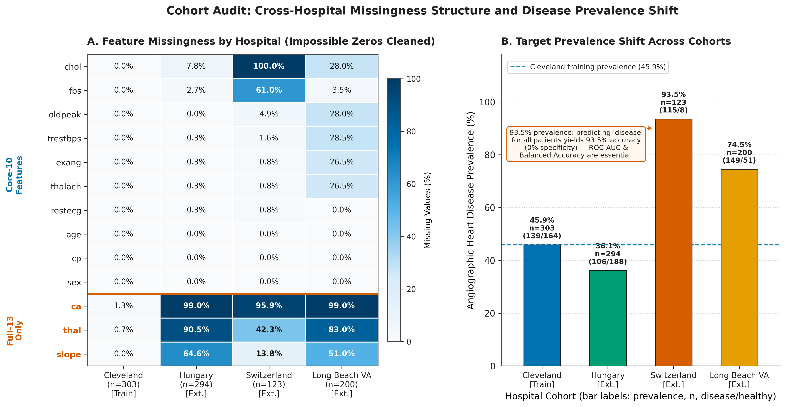
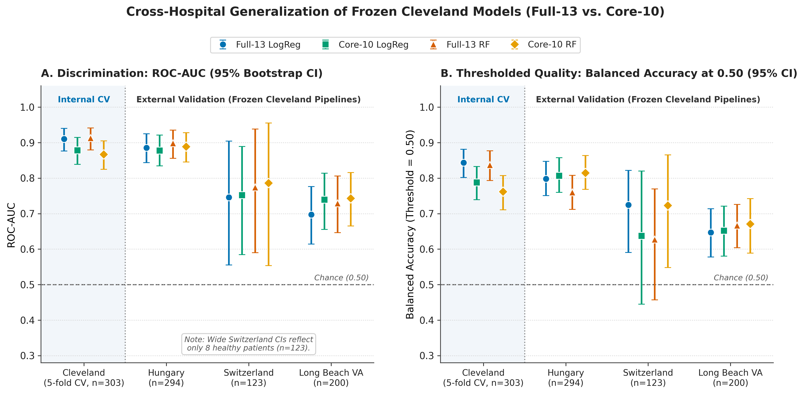
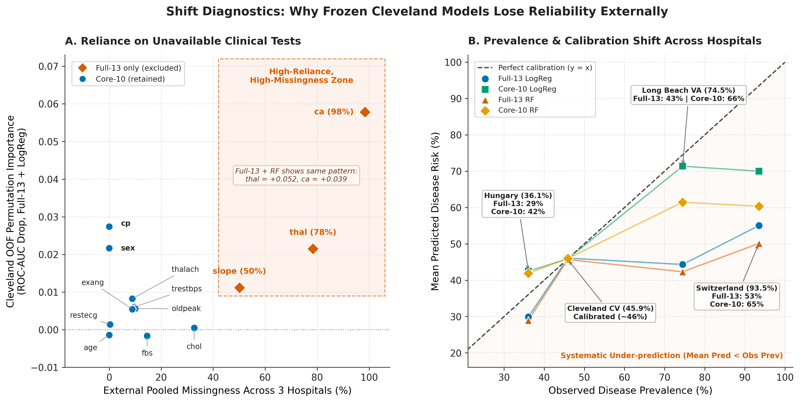

# Cross-Hospital External Validation of Heart Disease Prediction Under Clinical Dataset Shift

**Abstract.** Single-center clinical prediction models often excel under internal cross-validation while degrading across hospitals. Using all four UCI Heart Disease cohorts ($N=920$), we tested whether frozen Cleveland-trained models ($n=303$) generalize to Hungary ($n=294$), Switzerland ($n=123$), and Long Beach VA ($n=200$), and diagnosed the underlying dataset shifts. In a pre-specified $2\times2$ design comparing 13-feature (`Full-13`) and portable 10-feature (`Core-10`, excluding `ca`, `thal`, `slope`) L2 Logistic Regression and depth-constrained Random Forest models, `Full-13` led internally (Cleveland 5-fold CV ROC-AUC `0.911–0.913` vs. `0.867–0.878`). Externally, discrimination fell in Switzerland (`0.746–0.786`) and VA (`0.698–0.743`), where `Core-10` surpassed `Full-13` on ROC-AUC and substantially improved pooled Balanced Accuracy (`0.774–0.782` vs. `0.720–0.738`), Sensitivity (`0.746–0.808` vs. `0.505–0.573`), and Brier Score (`0.151–0.158` vs. `0.208–0.209`). Healthy-default imputation under severe missingness, prevalence shift (`36.1%–93.5%`), covariate shift, and sentinel zero encodings explain this gap.

---

## 1. Motivation & Research Question

Standard tutorials on the UCI Cleveland heart disease cohort ($n=303$) train on all 13 clinical predictors and report single-site ROC-AUC above `0.90`. Single-hospital validation, however, overestimates clinical transportability because test availability, coding conventions, and patient case-mix vary sharply across institutions. Although the UCI archive contains three additional hospitals sharing the same schema (Janosi et al., 1988; Detrano et al., 1989), they are rarely evaluated externally.

**Research Question:** *Do heart disease prediction models trained on Cleveland ($n=303$) generalize to three independent external hospitals (Hungary, Switzerland, Long Beach VA), and which cross-hospital data shifts explain changes in discrimination, decision quality, and calibration?*

---

## 2. Data & Pre-Specified Protocol

All modeling and evaluation decisions were locked in `MASTERPLAN.md` before training (`random_state=42`):

* **Cohorts & Outcome:** Four angiographic referral cohorts ($N=920$): Cleveland ($n=303$), Hungary ($n=294$), Switzerland ($n=123$), and Long Beach VA ($n=200$). Ordinal stenosis `num` was binarized to `target=1` (`num > 0`, $>50\%$ narrowing) vs. `0` (`num == 0`).
* **Data Hygiene & Zero-Leakage Pipelines:** Explicit `?` tokens and biologically impossible zeros (`chol == 0`, `trestbps == 0`) were recoded to `NaN`. Preprocessing lived inside a `scikit-learn` `Pipeline` (`ColumnTransformer`) fit strictly on Cleveland training data: median imputation + `StandardScaler` for numeric/count/binary features (`age`, `trestbps`, `chol`, `thalach`, `oldpeak`, `ca`, `sex`, `fbs`, `exang`) and mode imputation + `OneHotEncoder(handle_unknown="ignore")` for multi-level categoricals (`cp`, `restecg`, `slope`, `thal`).
* **Locked $2\times2$ Design:** `Full-13` (all 13 features) vs. `Core-10` (excluding `ca`, `thal`, `slope`) crossed with L2 Logistic Regression (`C=1.0`, `max_iter=1000`) and Random Forest (`n_estimators=300`, `max_depth=6`, `min_samples_leaf=5`).
* **Validation & Metrics:** Stratified 5-fold CV on Cleveland (pooled out-of-fold predictions) was compared against **frozen** pipelines refit on all 303 Cleveland patients (threshold `0.50`, no retraining or recalibration) across external hospitals and External Pooled ($n=617$), with 1,000-sample stratified bootstrap 95% CIs. We prioritized `ROC-AUC`, `Balanced Accuracy`, `Sensitivity`, `Specificity`, `PR-AUC`, and `Brier Score` (plus calibration gap = mean predicted risk minus observed prevalence), because raw accuracy fails under `93.5%` Swiss prevalence (where predicting "disease" for all yields `93.5%` accuracy at `0%` specificity).

---

## 3. Results

### 3.1 Cohort & Missingness Audit

Hospital cohorts diverge substantially before modeling (Figure 1). Cleveland has balanced prevalence (`45.9%`, 139/303; majority baseline `54.1%`), mean age `54.4` (SD `9.0`) yr, `68.0%` male, and low missingness (`2.0%` any-missing in `Full-13`, `0.0%` in `Core-10`). Externally, Hungary ($n=294$) is younger (`47.8 ± 7.8` yr, `72.4%` male, `36.1%` prevalence); Switzerland ($n=123$) is `91.9%` male (`55.3 ± 9.0` yr) with extreme prevalence (`93.5%`, 115 disease vs. 8 healthy); and Long Beach VA ($n=200$) is older (`59.4 ± 7.8` yr), `97.0%` male, and high-prevalence (`74.5%`, 149/200).

Externally ($n=617$), specialized tests `ca`, `thal`, and `slope` are missing in `98.4%`, `78.4%`, and `50.1%` of patients (vs. `1.3%`, `0.7%`, `0.0%` in Cleveland), leaving `99.5%–100.0%` of external records incomplete under `Full-13`. Recoding impossible zeros uncovered hidden missingness in `chol == 0` for `123/123` (`100.0%`) Swiss and `49/200` (`24.5%`) VA patients (`32.7%` pooled external `chol` missingness) and `trestbps == 0` in `1/200` (`0.5%`) VA patient (`28.5%` total VA `trestbps` missingness). Under `Core-10`, any-missingness drops to `11.2%` in Hungary and `51.5%` in VA (remaining `100.0%` in Switzerland via `chol`).

### 3.2 Internal vs. External Generalization

Internally on Cleveland CV (Table 1, Figure 2), `Full-13` clearly wins across every metric (`ROC-AUC 0.911–0.913` vs. `0.867–0.878`; `Balanced Accuracy 0.837–0.844` vs. `0.762–0.788`; `Brier 0.116–0.124` vs. `0.140–0.151`).

| Cohort (N, Prev.) | Model | ROC-AUC (95% CI) | Bal. Acc (95% CI) | Sens / Spec | Brier (95% CI) | Pred |
| --- | --- | --- | --- | --- | --- | --- |
| **Cleveland CV** (303, 45.9%) | Full-13 LogReg | 0.911 (0.876–0.940) | 0.844 (0.802–0.881) | 0.791 / 0.896 | 0.116 (0.093–0.140) | 0.461 |
| | Full-13 RF | 0.913 (0.880–0.941) | 0.837 (0.793–0.877) | 0.777 / 0.896 | 0.124 (0.107–0.142) | 0.457 |
| | Core-10 LogReg | 0.878 (0.839–0.914) | 0.788 (0.739–0.833) | 0.734 / 0.841 | 0.140 (0.117–0.166) | 0.459 |
| | Core-10 RF | 0.867 (0.825–0.905) | 0.762 (0.710–0.807) | 0.712 / 0.811 | 0.151 (0.133–0.170) | 0.460 |
| **Hungary** (294, 36.1%) | Full-13 LogReg | 0.885 (0.844–0.925) | 0.798 (0.751–0.847) | 0.660 / 0.936 | 0.127 (0.102–0.150) | 0.299 |
| | Full-13 RF | 0.898 (0.856–0.935) | 0.760 (0.712–0.808) | 0.557 / 0.963 | 0.139 (0.122–0.156) | 0.289 |
| | Core-10 LogReg | 0.878 (0.834–0.921) | 0.806 (0.760–0.857) | 0.783 / 0.830 | 0.134 (0.108–0.159) | 0.425 |
| | Core-10 RF | 0.889 (0.846–0.928) | 0.815 (0.768–0.864) | 0.736 / 0.894 | 0.132 (0.113–0.152) | 0.419 |
| **Switzerland** (123, 93.5%) | Full-13 LogReg | 0.746 (0.555–0.904) | 0.724 (0.591–0.822) | 0.574 / 0.875 | 0.263 (0.217–0.314) | 0.550 |
| | Full-13 RF | 0.774 (0.590–0.938) | 0.627 (0.457–0.770) | 0.504 / 0.750 | 0.265 (0.232–0.301) | 0.501 |
| | Core-10 LogReg | 0.752 (0.585–0.889) | 0.637 (0.445–0.820) | 0.774 / 0.500 | 0.159 (0.119–0.202) | 0.700 |
| | Core-10 RF | 0.786 (0.553–0.955) | 0.723 (0.548–0.865) | 0.696 / 0.750 | 0.178 (0.153–0.205) | 0.603 |
| **Long Beach VA** (200, 74.5%) | Full-13 LogReg | 0.698 (0.614–0.776) | 0.647 (0.578–0.714) | 0.510 / 0.784 | 0.297 (0.259–0.338) | 0.443 |
| | Full-13 RF | 0.729 (0.647–0.806) | 0.666 (0.604–0.726) | 0.470 / 0.863 | 0.276 (0.252–0.303) | 0.423 |
| | Core-10 LogReg | 0.739 (0.655–0.814) | 0.652 (0.580–0.721) | 0.852 / 0.451 | 0.172 (0.143–0.202) | 0.714 |
| | Core-10 RF | 0.743 (0.665–0.816) | 0.670 (0.589–0.742) | 0.792 / 0.549 | 0.183 (0.160–0.208) | 0.615 |
| **Ext. Pooled** (617, 60.0%) | Full-13 LogReg | 0.843 (0.812–0.873) | 0.738 (0.710–0.770) | 0.573 / 0.903 | 0.209 (0.188–0.229) | 0.396 |
| | Full-13 RF | 0.869 (0.839–0.897) | 0.720 (0.693–0.749) | 0.505 / 0.935 | 0.208 (0.195–0.223) | 0.375 |
| | Core-10 LogReg | 0.855 (0.824–0.885) | 0.774 (0.742–0.808) | 0.808 / 0.741 | 0.151 (0.132–0.169) | 0.573 |
| | Core-10 RF | 0.861 (0.831–0.892) | 0.782 (0.751–0.812) | 0.746 / 0.818 | 0.158 (0.143–0.170) | 0.519 |

Externally, that hierarchy reverses. In **Hungary**, ROC-AUC stays strong (`0.878–0.898`), while `Core-10` recovers `Full-13`'s sensitivity drop (`0.736–0.783` vs. `0.557–0.660`) and raises Balanced Accuracy (`0.806–0.815` vs. `0.760–0.798`). In **Switzerland** and **Long Beach VA**, discrimination drops (`0.698–0.786`), and `Core-10` surpasses `Full-13` on ROC-AUC for both classifiers (`+0.041`/`+0.014` in VA; `+0.007`/`+0.012` in Switzerland), cuts Brier Score by roughly one-third, and boosts sensitivity by `+0.191` to `+0.342`. In Switzerland, `Full-13 + LogReg` keeps higher Balanced Accuracy than `Core-10 + LogReg` (`0.724` vs. `0.637`) only because specificity on 8 healthy controls shifts from 7/8 to 4/8. On **External Pooled** ($n=617$), `Core-10` matches `Full-13` ROC-AUC while substantially improving Balanced Accuracy, Sensitivity, and Brier Score. Swiss raw accuracy (`0.520–0.756`) remains far below its `0.935` majority baseline.

### 3.3 Shift Diagnostics: Explaining Why Performance & Calibration Degrade

Four interacting shifts drive external degradation (Figure 3):

1. **Missingness Shift & Healthy-Default Imputation Bias:** Out-of-fold Cleveland permutation importance (Figure 3A) ranks `ca` (#1 LogReg: `0.058 ± 0.013` ROC-AUC drop, standardized $\beta=+1.092$, OR `2.98`; #2 RF: `0.039 ± 0.008`), `thal` (#1 RF: `0.052 ± 0.009`; #4 LogReg: `0.021 ± 0.008`, `thal=7` $\beta=+0.775$), and `slope` (#5 LogReg: `0.011 ± 0.006`) among top predictors—yet they are missing in `98.4%`, `78.4%`, and `50.1%` of external patients. Because Cleveland's median `ca=0`, mode `thal=3` (normal, `55.1%`; $\beta=-0.458$), and mode `slope=1` (upsloping, `46.9%`; $\beta=-0.466$) encode **healthy findings**, imputation systematically lowers `Full-13` risk predictions externally, collapsing pooled sensitivity (`0.505–0.573`).
2. **Prevalence & Calibration Shift:** Internally calibrated (gap `-0.002` to `+0.002`), frozen `Full-13` models severely under-predict risk in Switzerland (gap `-0.385` LogReg, `-0.434` RF) and VA (`-0.302`, `-0.322`), and even under-predict Hungary (`-0.062`, `-0.071`; Figure 3B). `Core-10` removes the imputation bias—bringing VA LogReg near calibration-in-the-large (gap `-0.031`) and shrinking Switzerland's gap (`-0.235`/`-0.332`)—while shifting Hungary to mild over-prediction (`+0.064`/`+0.058`) consistent with Cleveland's higher training prevalence (`45.9%` vs. `36.1%`).
3. **Covariate Shift:** Standardized mean differences (SMDs, External minus Cleveland) show marked shifts: lower `thalach` in VA (`-1.195`), Switzerland (`-1.146`), Hungary (`-0.451`), and Pooled (`-0.772`); higher male share in VA (`+0.826`) and Switzerland (`+0.625`); younger patients in Hungary (`-0.783`) vs. older in VA (`+0.581`); and elevated `exang` (`+0.675`) and `fbs` (`+0.484`) in VA.
4. **Data-Hygiene Sensitivity Check:** Leaving `chol == 0` uncleaned passes `0 mg/dL` ($\approx4.8$ SD below Cleveland's `246.7 ± 51.8 mg/dL`) through positive cholesterol coefficients (`+0.213` Full-13, `+0.252` Core-10). In Switzerland, this degrades Logistic Regression calibration and decisions: mean predicted risk falls `-0.161` (`Full-13`) and `-0.183` (`Core-10`), Brier worsens `+0.149` (`0.263` to `0.413`) and `+0.128` (`0.159` to `0.287`), and sensitivity drops `-0.183` in both (`Full-13` Balanced Accuracy `-0.091`; max per-patient shift `0.243–0.286`), while ROC-AUC is unchanged (`Δ=0.000`) under a constant log-odds offset. In VA (`24.5%` zeros), uncleaned zeros also cut LogReg ROC-AUC (`-0.010` Full-13, `-0.013` Core-10), worsen Brier (`+0.027`/`+0.020`), and lower `Core-10` sensitivity (`0.852` to `0.758`). Random Forest is far more resilient because splits saturate at training minimums (Switzerland Brier `+0.016`/`+0.013`; VA `+0.0014`/`+0.0005`).

---

## 4. Discussion, Clinical Implications & Limitations

Internal Cleveland CV overstates transportability by masking feature-availability collapse, directional imputation bias, and prevalence-driven miscalibration. Adopting portable predictors (`Core-10`) trades modest internal discrimination (`-0.032` to `-0.046` ROC-AUC) for markedly better external calibration, sensitivity, and balanced accuracy.

Four limitations apply: (1) small external samples—notably Switzerland ($n=123$, 8 healthy controls), causing wide ROC-AUC CIs (widths `0.30–0.40`) and noisy specificity (`12.5` percentage points per control); (2) historical 1988 angiographic referral cohorts with strong symptomatic and male selection bias (`68.0%–97.0%`), predating contemporary biomarkers and noninvasive imaging; (3) pre-specified single imputation (`SimpleImputer`), which guarantees zero-leakage reproducibility but ignores imputation uncertainty and informative missingness (multiple imputation or missingness-aware models merit evaluation, though missingness indicators themselves degrade when ordering policies shift); and (4) intentional omission of external recalibration and threshold tuning to measure raw transportability—clinically, local intercept recalibration (*calibration-in-the-large*; Van Calster et al., 2019) using site prevalence is an essential next step.

**Clinical ML Takeaways:** Audit cross-site test availability and sentinel encodings before feature selection; report discrimination, balanced threshold metrics, and calibration with CIs per TRIPOD (Collins et al., 2015); and verify that training imputation defaults do not suppress external risk.

---

## 5. References

1. Janosi, A., Steinbrunn, W., Pfisterer, M., & Detrano, R. (1988). *Heart Disease* [Dataset]. UCI Machine Learning Repository. https://doi.org/10.24432/C52P4X
2. Detrano, R., Janosi, A., Steinbrunn, W., Pfisterer, M., Schmid, J.-J., Sandhu, S., Guppy, K. H., Lee, S., & Froelicher, V. (1989). International application of a new probability algorithm for the diagnosis of coronary artery disease. *Am J Cardiol*, 64(5), 304–310.
3. Collins, G. S., Reitsma, J. B., Altman, D. G., & Moons, K. G. M. (2015). Transparent reporting of a multivariable prediction model for individual prognosis or diagnosis (TRIPOD). *BMJ*, 350, g7594.
4. Van Calster, B., McLernon, D. J., van Smeden, M., Wynants, L., & Steyerberg, E. W. (2019). Calibration: The Achilles heel of predictive analytics. *BMC Medicine*, 17, 230.
